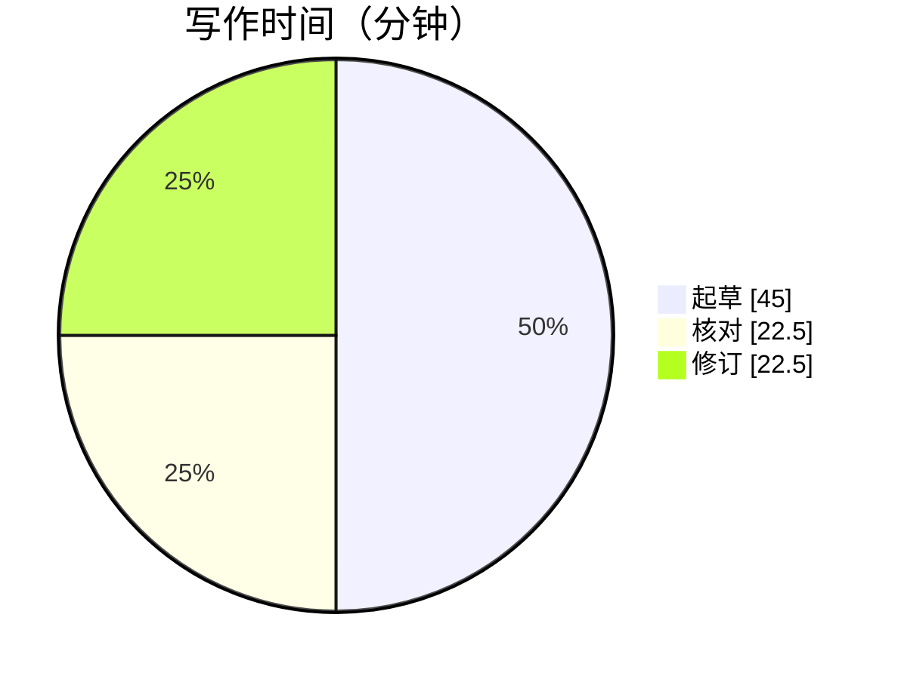
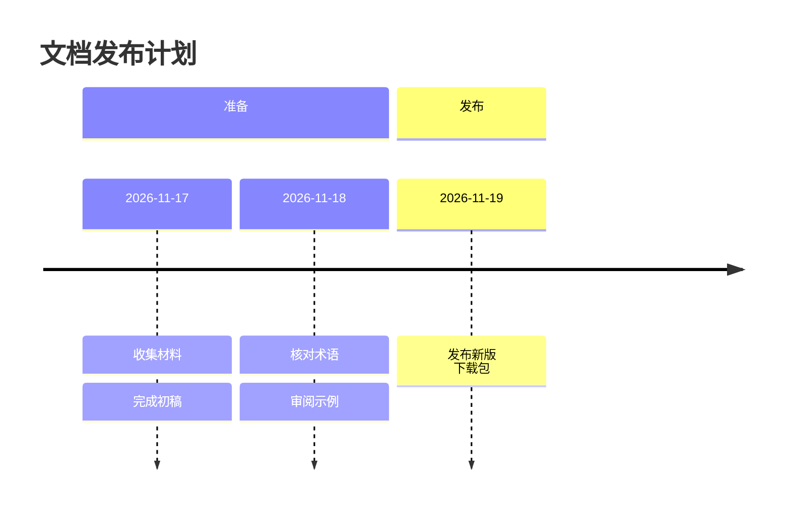
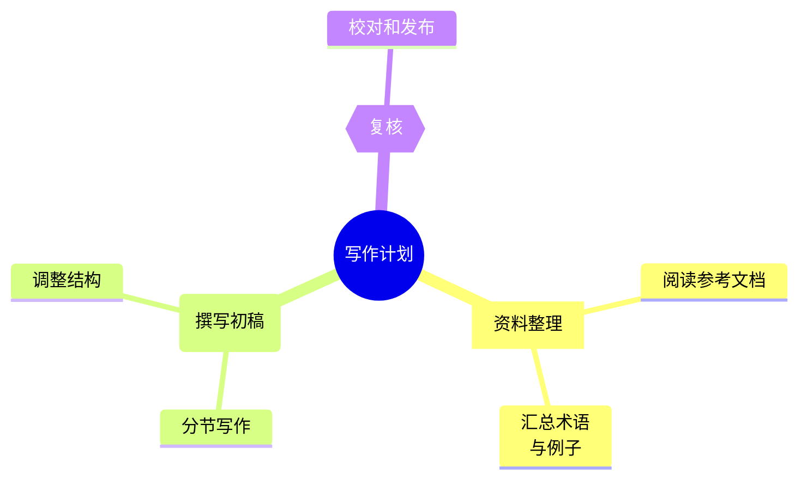
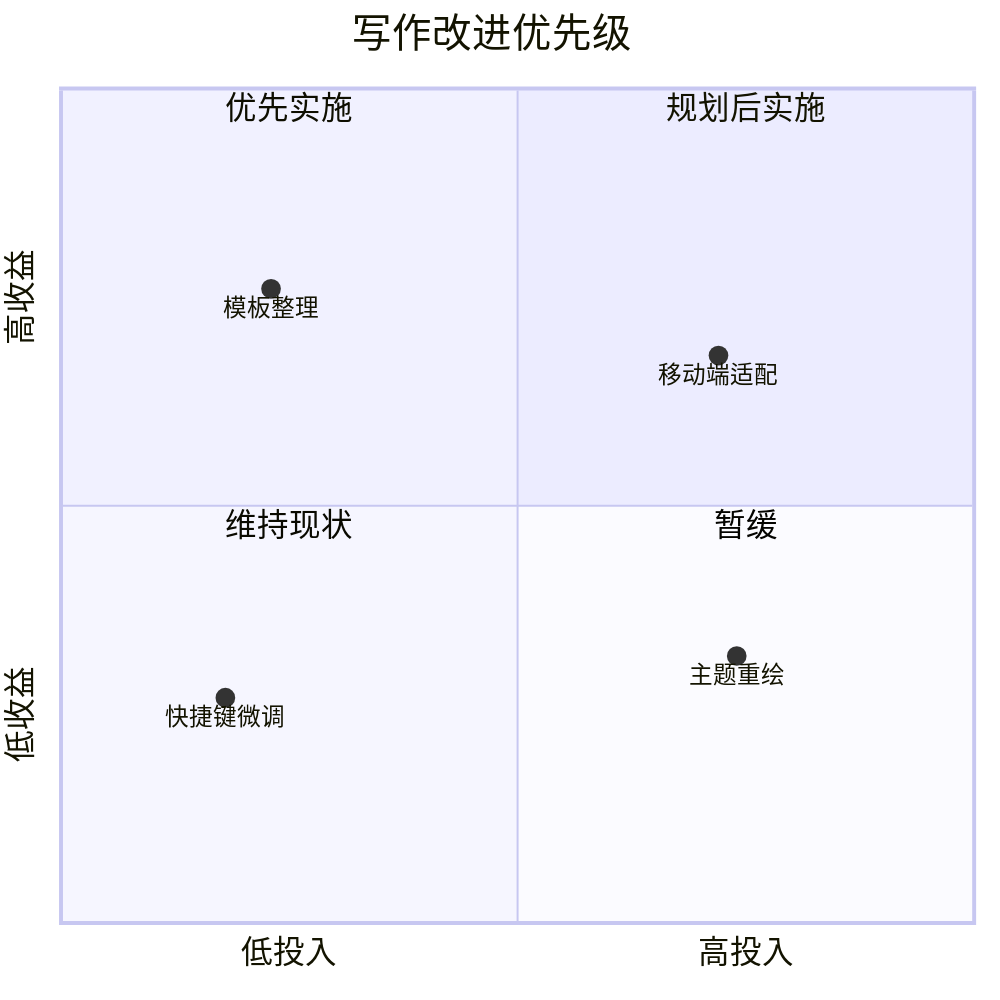
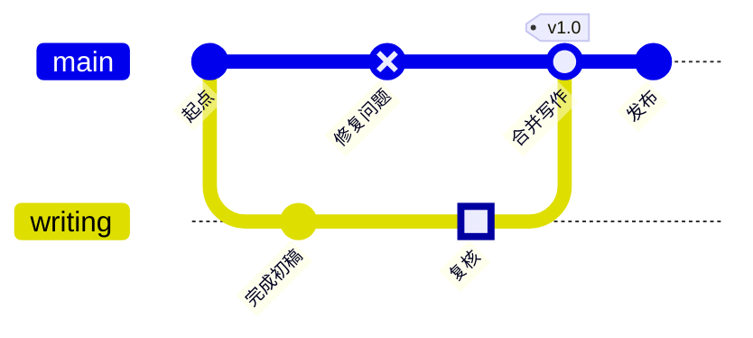
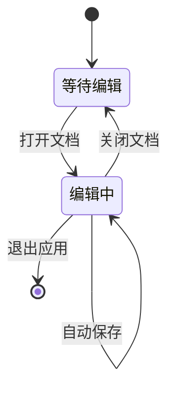
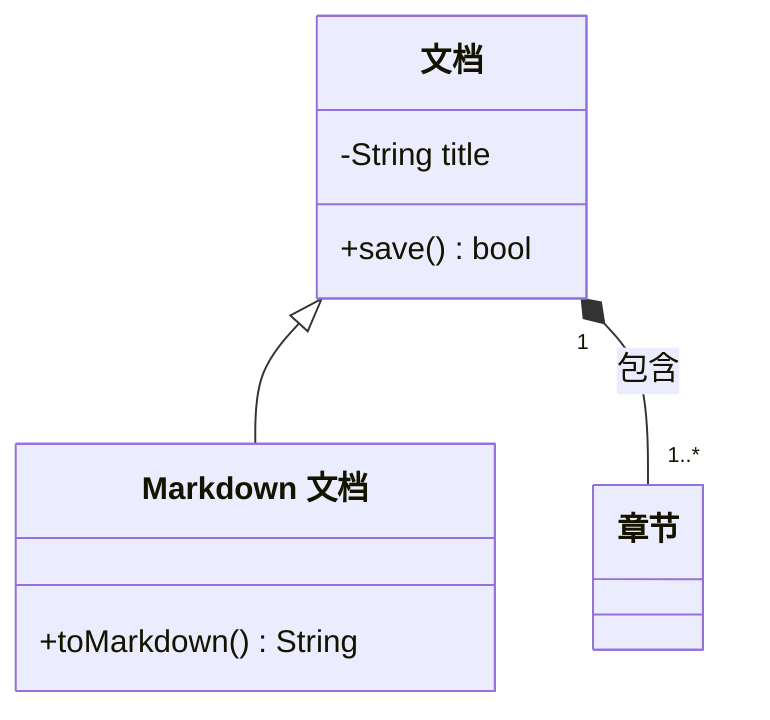
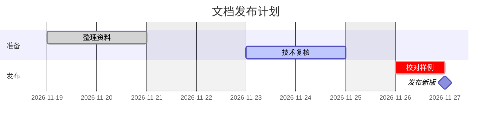

# 公式、图表、脚注和目录

在「段落」菜单插入数学公式块、Mermaid 图表或目录；在「格式」菜单插入行内公式或脚注。数学公式块快捷键为 `Ctrl+Shift+M`。

行内公式写作 `$E=mc^2$`。输入闭合的 `$` 后自动渲染；独立公式使用单独成行的 `$$` 包围。公式支持分数、根式、上下标、求和、积分、矩阵等 LaTeX 数学排版。双击已渲染公式可打开源码与预览，修改后可撤销。未能渲染的公式保留原文，可切到源码模式修改。

Mermaid 使用带 `mermaid` 语言标记的代码围栏。目前支持 `flowchart / graph` 的 TD、TB、BT、LR、RL 方向，矩形、圆角、圆形、菱形节点，普通与虚线连接、边标签、分支和环；支持 `sequenceDiagram` 的 participant / actor、消息、返回消息、autonumber、Note over。subgraph、样式指令和复杂时序控制等保留为源码，避免显示不完整图形。actor 当前使用统一参与者标题框。


`pie` 绘制饼图。用双引号包围名称，每行写一个数值。扇区按源码顺序顺时针排列，图例可通过 `showData` 显示数值。标题可写在 `pie` 同一行或单独一行。支持整数和小数，最多 64 项，并要求总值大于零。零值留在图例中。 [Mermaid 饼图语法](https://mermaid.js.org/syntax/pie.html)



`timeline` 按源码顺序绘制时间线。用 `title` 添加标题，用 `section` 分组，事件可用冒号和空格接在时期后，或在续行以冒号和空格开头。时期和事件支持文字、日期以及 `<br>` 换行。每行最多放四个时期，时间线最多支持 24 个时期和 64 个事件。 [Mermaid 时间线语法](https://mermaid.js.org/syntax/timeline)



`mindmap` 按缩进组织节点。首个节点是根，每行接到最近一个缩进更少的节点。一级分支分布在根节点两侧，同一分支及其后代使用相同的配色。支持普通文字、方框 `id[名称]`、圆角框 `id(名称)`、圆形 `id((名称))`、六边形 `id{{名称}}`、云形 `id)名称(` 和星芒 `id))名称((`。

标签支持中文自动换行与 `<br>`，每个节点最多显示四行，完整文字保留在源码中。可在节点后另起一行用 `::icon(fa fa-book)`、`fa-lightbulb` 或 `fa-check` 加入内置的书本、灯泡和对勾图标。单图最多 48 个节点、8 层。其他图标、Markdown 富文本标签、自定义样式和配置保留为可编辑源码。 [Mermaid 思维导图语法](https://mermaid.js.org/syntax/mindmap.html)



`quadrantChart` 绘制四象限图。可用 `title` 添加标题、用 `x-axis` 和 `y-axis` 写轴的两端文字，也可只写低值端。象限编号从右上方起逆时针排列。用 `名称: [x, y]` 添加散点，两坐标均在 0 到 1 之间，最多 32 个点。省略散点时可用作空白矩阵。标注密集时，图内放不下的点名和坐标会列在图下。过长的标签会截短显示，源码保留完整内容。点样式、样式类及图表配置会保留为可编辑源码。 [Mermaid 四象限图语法](https://mermaid.js.org/syntax/quadrantChart.html)



`sankey` 和 `sankey-beta` 绘制桑基图。每条记录按来源、去向、数值填写三列 CSV。名称中包含逗号或换行时用双引号包围，字段内的双引号写作两个连续引号。空行及 `%%` 注释行可以用于分组。

图从左向右展示分流和汇流。流带宽度与数值成比例，节点旁显示流入或流出两者中的较大总量。同一对节点的多条记录会合并为一条流带，零值记录不生成流带。支持最多 64 个节点和 128 条记录，至少一条记录需要正值。循环流向和自定义配置保留为可编辑源码。 [Mermaid 桑基图语法](https://mermaid.js.org/syntax/sankey.html)

```mermaid
sankey
    %% 来源,去向,工作量
    写作计划,整理素材,12
    写作计划,直接起草,8
    整理素材,撰写正文,9
    整理素材,参考归档,3
    直接起草,撰写正文,8
    撰写正文,"复核、校对",17
```

`gitGraph` 绘制 Git 分支和提交历史。初始分支为 `main`。用 `commit` 添加提交、`branch` 创建并切换分支、`checkout` 或 `switch` 切换已有分支，再用 `merge` 合并另一分支的最新提交。用 `id: "名称"` 添加提交名称、用 `tag: "版本"` 添加标签。未指定 ID 的提交按顺序显示为 `c1`、`c2`。

用 `type: HIGHLIGHT` 突出显示提交，`type: REVERSE` 表示撤销，合并提交带双圈。分支默认按创建顺序排布，可用 `branch 名称 order: 正整数` 排序；带顺序值的分支排在其余分支之后，`main` 始终在首位。可选择 `gitGraph LR:`、`gitGraph TB:` 或 `gitGraph BT:` 布局。支持最多 8 个分支与 32 个提交。过长的名称会截短显示，源码保留完整内容。`cherry-pick` 与自定义配置保留为可编辑源码。 [Mermaid GitGraph 语法](https://mermaid.js.org/syntax/gitgraph.html)



`xychart` 和 `xychart-beta` 支持柱形图 `bar`、折线图 `line` 和组合图。在图表声明后加 `horizontal` 可以横向绘制。两条轴都可命名，X 轴可指定类别或数值范围，Y 轴可指定范围或由数据推算。柱形图自动推算时包含零点。带名称的系列显示在图例中。

类别与数据按位置对应。图表最多支持 8 个系列，每个系列最多 32 个值。标签较密时会减少刻度标签，导出仍保留全部已绘制数据。 [Mermaid XY 图语法](https://mermaid.js.org/syntax/xyChart)

```mermaid
xychart
    title "每月产量（件）"
    x-axis "月份" [一月, 二月, 三月, 四月]
    y-axis "数量" 0 --> 100
    bar "实际" [40, 65, 72, 83]
    line "目标" [50, 60, 75, 80]
```

`stateDiagram` 和 `stateDiagram-v2` 绘制基础状态图。用 `[*]` 表示开始或结束，用 `-->` 连接状态。冒号后的文字可说明状态或转换，`state "显示名称" as ID` 可为状态命名。支持方向设置、双向转换、自转换与 `<<choice>>` 分支。复合状态、并发、注释框和自定义样式保留为可编辑源码。 [Mermaid 状态图语法](https://mermaid.js.org/syntax/stateDiagram.html)



`classDiagram` 支持类名、自定义显示名称、类注解、属性和方法。成员可写在类的花括号内，也可写作 `Class : 成员`。保留可见性符号，静态成员加下划线，抽象方法用斜体。支持继承、实现、组合、聚合、关联与依赖，关系可附文字说明和双端多重性。用 `direction` 设置上下或左右布局。单图最多 24 个类、48 条关系，每类最多 18 个成员。命名空间、泛型、笔记、交互和样式指令保留为可编辑源码。 [Mermaid 类图语法](https://mermaid.js.org/syntax/classDiagram.html)



`gantt` 绘制按日期排列的项目计划。用 `title` 添加标题、`section` 分组。日期采用 `YYYY-MM-DD`，工期支持分钟 `m`、小时 `h`、天 `d` 和周 `w`，精确到分钟。可直接写开始和结束日期，也可指定任务 ID，通过 `after` 接续一个或多个任务；省略开始时间时接续上一项，首项须提供日期或依赖。使用 `done`、`active`、`crit` 和 `milestone` 标记状态。

`excludes` 可指定 `weekends` 或单个日期。排除日在图中有底色。以工期指定的任务遇到排除日时会顺延。任务尾部遇到排除日时，图条在休假前结束，后续任务从休假后接续。明确指定结束日期的任务保留原日期。单图最多 24 项任务和约十年跨度。自定义日期格式、`until`、自定义坐标轴或样式会保留为可编辑源码。 [Mermaid 甘特图语法](https://mermaid.js.org/syntax/gantt.html)



脚注使用 `[^note]` 引用和 `[^note]: 注释内容` 定义；后续行缩进四个空格。点击引用跳转到定义，正文与定义均保留在 Markdown 中，未引用的定义也会保留。定义区当前直接展示可编辑的原始内容。Word 导出使用原生脚注；HTML 输出带跳转的脚注区；PDF 将定义放在文末。

单独一段的 `[TOC]` 或 `[toc]` 会生成正文目录，也可输入后按 Enter 渲染。目录根据当前标题自动更新，点击条目跳到对应标题。保存时仍是 `[TOC]`，生成文字不会写回 Markdown。PDF 将目录展开为可跨页的段落；Word 输出包含缓存条目与内部链接的 TOC 域，可在 Word 中更新目录。

HTML / PDF / DOCX 中的公式和受支持图表内嵌为双倍分辨率图片。Word 中的公式图片不能作为原生公式对象编辑；继续修改原始 Markdown 可重新导出。HTML 无需外部脚本或网络。引用、嵌套结构中无法原生排版的块保留 Markdown 源码；代码围栏内、行内代码、转义美元符号与常见货币文本不会被改成公式。
