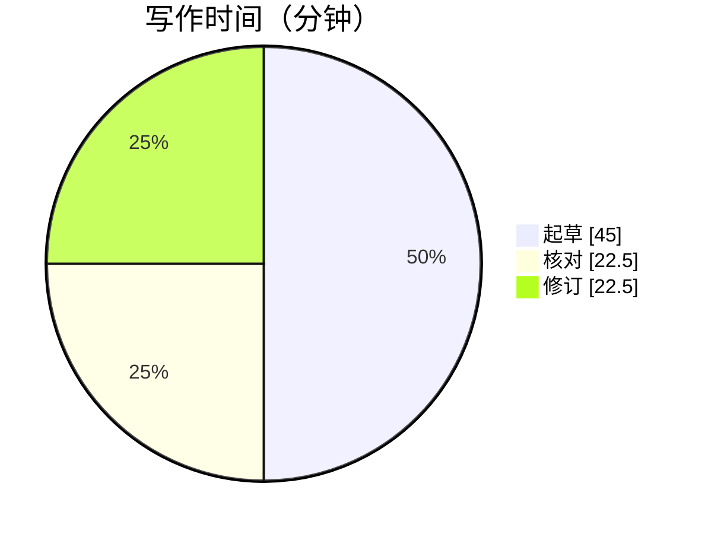
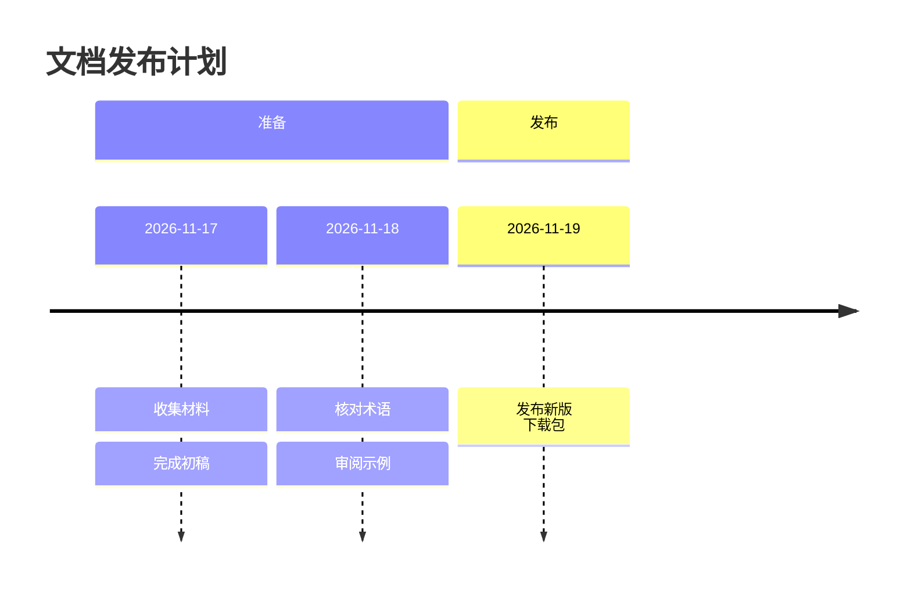

# 公式、图表、脚注和目录

在「段落」菜单插入数学公式块、Mermaid 图表或目录；在「格式」菜单插入行内公式或脚注。数学公式块快捷键为 `Ctrl+Shift+M`。

行内公式写作 `$E=mc^2$`。输入闭合的 `$` 后自动渲染；独立公式使用单独成行的 `$$` 包围。公式支持分数、根式、上下标、求和、积分、矩阵等 LaTeX 数学排版。双击已渲染公式可打开源码与预览，修改后可撤销。未能渲染的公式保留原文，可切到源码模式修改。

Mermaid 使用带 `mermaid` 语言标记的代码围栏。目前支持 `flowchart / graph` 的 TD、TB、BT、LR、RL 方向，矩形、圆角、圆形、菱形节点，普通与虚线连接、边标签、分支和环；支持 `sequenceDiagram` 的 participant / actor、消息、返回消息、autonumber、Note over。此实现的目标是离线原生排版，目前并不覆盖 Mermaid 的完整语法。subgraph、样式指令、复杂时序控制、甘特图、类图等保留为源码，避免显示不完整图形。actor 当前使用统一参与者标题框。


`pie` 绘制饼图。用双引号包围名称，每行写一个数值。扇区按源码顺序顺时针排列，图例可通过 `showData` 显示数值。标题可写在 `pie` 同一行或单独一行。支持整数和小数，最多 64 项，并要求总值大于零。零值留在图例中。 [Mermaid 饼图语法](https://mermaid.js.org/syntax/pie.html)



`timeline` 按源码顺序绘制时间线。用 `title` 添加标题，用 `section` 分组，事件可用冒号和空格接在时期后，或在续行以冒号和空格开头。时期和事件支持文字、日期以及 `<br>` 换行。每行最多放四个时期，时间线最多支持 24 个时期和 64 个事件。 [Mermaid 时间线语法](https://mermaid.js.org/syntax/timeline)



`xychart` 和 `xychart-beta` 支持柱形图 `bar`、折线图 `line` 和组合图。在图表声明后加 `horizontal` 可以横向绘制。两条轴都可命名，X 轴可指定类别或数值范围，Y 轴可指定范围或由数据推算。柱形图自动推算时包含零点。带名称的系列显示在图例中。

类别与数据按位置对应。图表最多支持 8 个系列，每个系列最多 32 个值。标签较密时会减少刻度标签，导出仍保留全部已绘制数据。 [Mermaid XY 图语法](https://mermaid.js.org/syntax/xyChart)

```mermaid
xychart
    title "每月产量（件）"
    x-axis "月份" [一月, 二月, 三月, 四月]
    y-axis "数量" 0 --> 100
    bar "实际" [40, 65, 72, 83]
    line "目标" [50, 60, 75, 80]
```

脚注使用 `[^note]` 引用和 `[^note]: 注释内容` 定义；后续行缩进四个空格。点击引用跳转到定义，正文与定义均保留在 Markdown 中，未引用的定义也会保留。定义区当前直接展示可编辑的原始内容。Word 导出使用原生脚注；HTML 输出带跳转的脚注区；PDF 将定义放在文末。

单独一段的 `[TOC]` 或 `[toc]` 会生成正文目录，也可输入后按 Enter 渲染。目录根据当前标题自动更新，点击条目跳到对应标题。保存时仍是 `[TOC]`，生成文字不会写回 Markdown。PDF 将目录展开为可跨页的段落；Word 输出包含缓存条目与内部链接的 TOC 域，可在 Word 中更新目录。

HTML / PDF / DOCX 中的公式和受支持图表内嵌为双倍分辨率图片。Word 中的公式图片不能作为原生公式对象编辑；继续修改原始 Markdown 可重新导出。HTML 无需外部脚本或网络。引用、嵌套结构中无法原生排版的块保留 Markdown 源码；代码围栏内、行内代码、转义美元符号与常见货币文本不会被改成公式。
