# 公式、图表、脚注和目录

在「段落」菜单插入数学公式块、Mermaid 图表或目录；在「格式」菜单插入行内公式或脚注。数学公式块快捷键为 `Ctrl+Shift+M`。

行内公式写作 `$E=mc^2$`。输入闭合的 `$` 后自动渲染；独立公式使用单独成行的 `$$` 包围。公式支持分数、根式、上下标、求和、积分、矩阵等 LaTeX 数学排版。双击已渲染公式可打开源码与预览，修改后可撤销。未能渲染的公式保留原文，可切到源码模式修改。

Mermaid 使用带 `mermaid` 语言标记的代码围栏。`flowchart / graph` 支持 TD、TB、BT、LR、RL 方向，14 种常用节点、普通与虚线连接、边标签、分支和环。箭头连接到节点的实际轮廓，圆形和双圆保持圆形比例，并为标签预留空间。 [Mermaid 节点形状](https://mermaid.js.org/syntax/flowchart.html#node-shapes)

| 形状 | 语法 |
| --- | --- |
| 矩形 | `A[文字]` |
| 圆角矩形 | `A(文字)` |
| 圆形 / 双圆 | `A((文字))` / `A(((文字)))` |
| 菱形 / 六边形 | `A{文字}` / `A{{文字}}` |
| 胶囊 | `A([文字])` |
| 子程序 | `A[[文字]]` |
| 数据库圆柱 | `A[(文字)]` |
| 非对称节点 | `A>文字]` |
| 平行四边形 / 反向 | `A[/文字/]` / `A[\文字\]` |
| 梯形 / 倒梯形 | `A[/文字\]` / `A[\文字/]` |

标签支持中文、`<br>` 换行，以及双引号包围的文字，如 `A["保存 [草稿]; 资源"]`。标签中含形状定界符时请加双引号；非对称节点标签中的分号也需放在引号内。分号可分隔同一行的多个声明，后续只引用节点 ID 会沿用已有形状，重复声明使用最后的形状和名称。最多支持 64 个节点与 128 条连接。缺失或错配的定界符、subgraph 及 `@{shape: ...}` 等其他形状配置保留为可编辑源码。

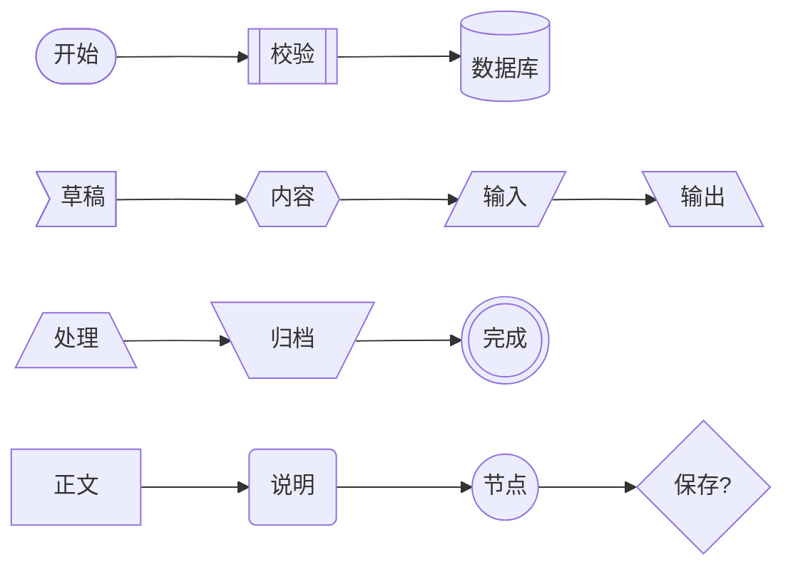

流程图连线支持以下线型和端头；粗线使用更宽的笔画，圆点端头为空心圆，叉号端头绘制为叉号。三种线型均可组合两端端头，例如 `<==>` 或 `o-.-o`。 [Mermaid 连线与箭头](https://mermaid.js.org/syntax/flowchart.html#links-between-nodes)

| 连接 | 语法 |
| --- | --- |
| 实线箭头 / 无端头实线 | `-->` / `---` |
| 虚线箭头 / 无端头虚线 | `-.->` / `-.-` |
| 粗线箭头 / 无端头粗线 | `==>` / `===` |
| 圆点 / 叉号端头 | `--o` / `--x` |
| 双向箭头 / 双圆点 / 双叉号 | `<-->` / `o--o` / `x--x` |
| 不可见布局连线 | `~~~` |

文字可写在竖线之间，如 `A -->|保存| B`；也可写在分开的连线标记之间，如 `A -- 保存 --> B`、`A -. 结果 .-> B` 和 `A == 保存 ==> B`。无端头连接和双端连接也支持文字。文字包含箭头标记时使用双引号，如 `A -- "显示 --> 标记" --> B`。不可见连接只影响节点布局，不绘制线或文字；给不可见连接添加非空标签会保留为源码。

`A --> A` 等自连接在节点右侧绘制为环线，可使用上述端头和线型。排版会为环线及标签预留横向空间；环线标签显示为一行，过长时省略，完整文字保留在源码与保存文件中。同一对节点的多条连接可能共用路径。

节点 ID 以小写 `o` 或 `x` 开头时，与无端头连接之间留空格，例如 `A --- oNode`，以免被当作圆点或叉号端头；`A---oB` 表示到 `B` 的加长圆点连线。

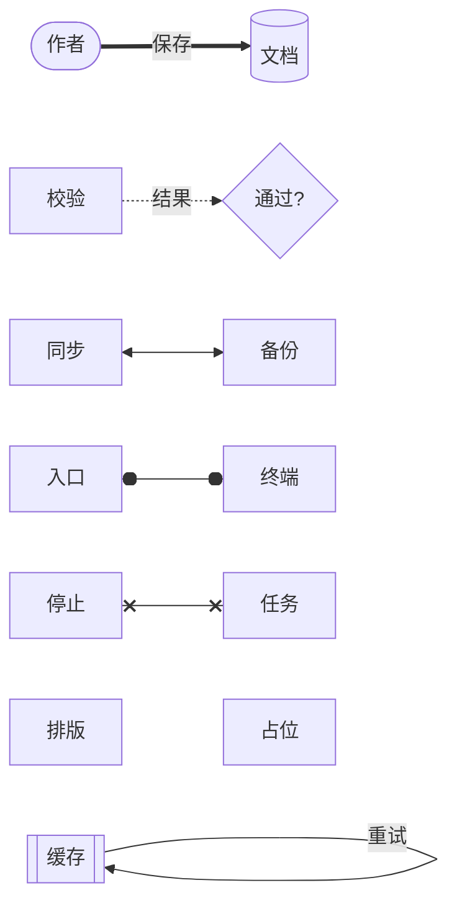

使用 `&` 可同时声明多个节点，或将两组节点组合连接。`A & B --> C & D --> E` 等价于 `A`、`B` 分别连接 `C`、`D`，再由 `C`、`D` 分别连接 `E`；每段链式连接独立使用自己的线型、端头和标签。节点的形状和显示名称仍可在组内声明；节点文字里的 `&` 不会分组。重复引用不会创建新节点，但显式重复的连接会保留。每组最多 64 个引用，全图最多 64 个节点，组合展开后的连接不得超过 128 条。 [Mermaid 链式连接](https://mermaid.js.org/syntax/flowchart.html#chaining-of-links)

加长连接标记可请求更多布局层级的最短跨度；无环图中的汇合节点取所有输入约束中的最大值，后续节点也会相应后移。普通和粗线增加 `-` 或 `=`，虚线增加 `.`，不可见布局连线增加 `~`。行内文字形式在文字右侧加长，如 `A -- 通过 ----> B`。支持每条连接 1–8 层，超出范围保留为源码。 [Mermaid 连线最短长度](https://mermaid.js.org/syntax/flowchart.html#minimum-length-of-a-link)

| 最短跨度 | 1 层 | 2 层 | 3 层 |
| --- | --- | --- | --- |
| 普通箭头 | `-->` | `--->` | `---->` |
| 无端头实线 | `---` | `----` | `-----` |
| 粗线箭头 | `==>` | `===>` | `====>` |
| 虚线箭头 | `-.->` | `-..->` | `-...->` |
| 不可见连线 | `~~~` | `~~~~` | `~~~~~` |

连接若会穿过其他节点，会绕到图的外侧，并为路径和标签留出画布。外侧路径的标签同环线一样显示为一行，过长省略，完整源码不变。不同连接仍可能交叉或共用路径。含环图采用有限、确定的回退层级，不能同时保证环上所有连线的最短跨度；自连接环线不增加层级。

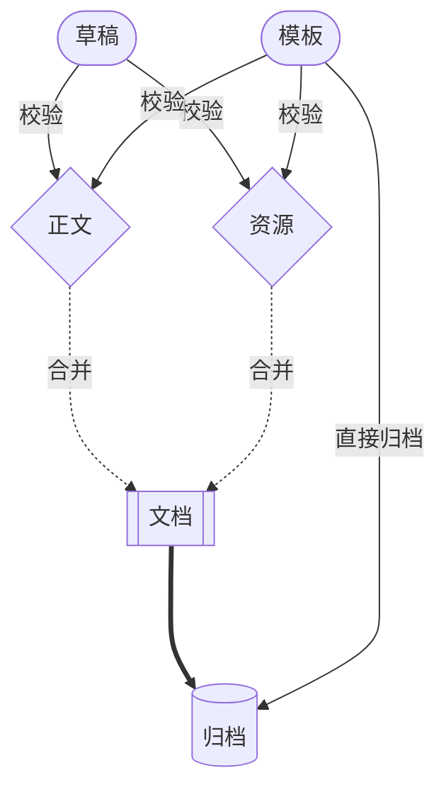

流程图节点可通过 `style A 属性` 单独设置外观，或用 `classDef 类名 属性` 定义可复用样式，再以 `class A,B 类名` 赋给已声明节点。`A[文字]:::类名` 是附加样式类的简写，支持在 `&` 分组和链式连接中使用；类定义可以放在引用之后。`style` 在节点尚未声明时会创建以 ID 为名称的节点，后续可补充形状和名称。 [Mermaid 节点样式与类](https://mermaid.js.org/syntax/flowchart.html#styling-a-node)

| 属性 | 支持的值 |
| --- | --- |
| `fill` / `stroke` / `color` | 填充色 / 边框色 / 文字色；SVG 命名颜色、`#RGB`、`#RGBA`、`#RRGGBB`、`#RRGGBBAA`、`rgb()` 和 `rgba()` |
| `stroke-width` | 0 或 0.1–12 的数字，可加 `px`；0 隐藏边框 |
| `stroke-dasharray` | 最多 8 个 0.1–64 的数字，可加 `px`，以空格或转义逗号分隔；奇数个值会重复成偶数个，`none` 恢复实线 |

颜色中的透明度使用 CSS 的最后一段，例如 `#ff000080` 为半透明红色；`rgb()` 的三个通道为 0–255 整数，`rgba()` 另加 0–1 透明度。Mermaid 用逗号分隔属性，值里的逗号需写为 `\,`，例如 `fill:rgba(255\,0\,0\,.5)` 或 `stroke-dasharray:5\,3`。`transparent` 可作为透明颜色，`fill:none` 和 `stroke:none` 分别隐藏填充或边框。

属性按「主题默认值 → `default` 类 → `node` 公共类 → 按附加顺序的命名类 → 节点 `style`」叠加。重复定义只覆盖本次指定的属性，同一属性以最后的值为准；未指定的属性沿用前一层。显式颜色在浅深主题中保持不变，文字色只影响节点名称，连线和标签仍用主题颜色。虚线长度以像素计算，不随边框粗细成比例变长。

全图最多 32 个样式类，每个节点最多附加 16 次类，每次样式声明最多 32 个属性。缺失的类、`class` 指向尚未声明的节点、无效颜色、超限数字及不支持的属性均保留为可编辑源码；字体、渐变、外部 CSS 和交互尚未支持。

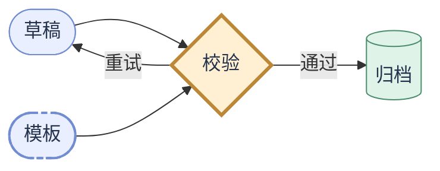

使用 `linkStyle 编号 属性` 设置指定连线，编号从 0 开始；多个编号可用逗号分隔，如 `linkStyle 0,2 stroke:blue`。`linkStyle default 属性` 提供全图连线的默认样式，可写在连线声明之前或之后。编号形式需放在对应连线已声明之后，每条声明最多 128 个编号。 [Mermaid 连线样式](https://mermaid.js.org/syntax/flowchart.html#styling-links)

| 属性 | 效果 |
| --- | --- |
| `stroke` | 连接路径与两端箭头、圆点或叉号的颜色；`none` 隐藏路径和端头 |
| `stroke-width` | 连接路径粗细，0 隐藏路径和端头；端头保持原有尺寸 |
| `stroke-dasharray` | 自定义虚线长度；`none` 将虚线恢复为实线 |
| `color` | 连线标签的文字颜色；未指定时使用主题文字色 |

颜色、粗细、虚线长度及转义逗号的写法沿用上方节点样式的数值范围；也接受无填充的 `fill:none` 或透明填充，其他填充保留为源码。属性按「连线语法（普通、虚线或粗线）→ 显式附加的样式类 → `linkStyle default` → 编号样式」的顺序叠加。对同一编号或 `default` 的后一次 `linkStyle` 声明会替换前一次的整组属性；只有最后一组生效，编号样式仍可继承当前 `default` 中的其他属性。

编号按连线的声明顺序计算；`&` 分组先按起点、再按终点顺序展开。例如 `A & B --> C & D` 的 0–3 依次为 `A→C`、`A→D`、`B→C`、`B→D`。自连接、重复连接和不可见连接均占编号。隐藏路径会保留节点布局和编号，标签仍可显示；不可见的 `~~~` 连线始终不绘制路径、端头或标签。显式配色在浅深主题中保持不变。动画、曲线配置、无效属性及越界编号保留为可编辑源码。

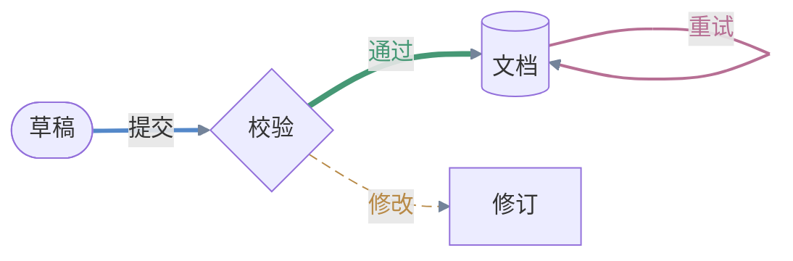

在连线前加 `ID@` 可命名连线，如 `A e1@--> B`，随后用 `class e1 类名` 附加样式。`class A,e1 类名` 可同时引用已声明的节点和命名连线；样式类定义可放在引用之后。支持已有的实线、虚线、粗线、双端端头、加长连接、行内文字、竖线标签、自连接和不可见连接。ID 不显示在图里，也不会新增节点或改变编号。 [Mermaid 连线 ID](https://mermaid.js.org/syntax/flowchart.html#attaching-an-id-to-edges)

ID 支持 ASCII 字母、数字、下划线和内部的单个连字符，区分大小写，且需紧挨 `@`；`@` 后可留空格。显式 ID 必须唯一，不能与节点 ID 重名。同一对节点的多条连接可使用不同 ID。分组写法 `A & B e1@--> C & D` 只将 `e1` 赋给 `B→C`（编号 2）；一般规则为最后一个起点值和第一个终点值对应的首条展开连线获得 ID，其余连接保留编号。重复引用同一端点时仍只命名首个匹配的连接。

每条命名连线最多附加 16 次样式类，类按附加顺序逐属性叠加，并继承既有的颜色、线宽和虚线范围限制。`classDef default` 和 `classDef node` 只自动应用于节点；连线需显式用 `class` 引用这些类。`linkStyle default` 和编号样式可覆盖类中的对应属性。连线最终样式含不透明 `fill` 时保留为源码，可用 `linkStyle default fill:none` 覆盖共享类中的填充。

重名、节点与连线 ID 冲突、未声明目标、缺失样式类、`style 边ID`、将边 ID 用作节点以及 JSON 元数据 / 动画 / 曲线配置均保留为可编辑源码。

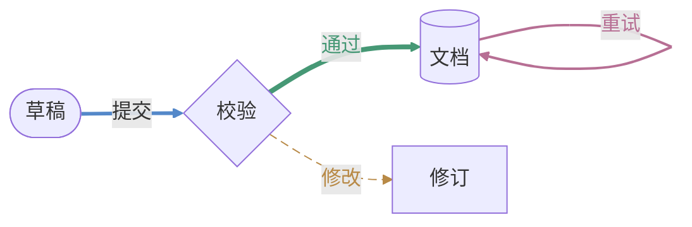

`sequenceDiagram` 支持 `participant` 参与者、`actor` 人物符号、显示别名、实线和虚线消息、自调用、`autonumber` 以及 `Note over` 注释。可用 `alt / else` 表示条件分支、`opt` 表示可选操作、`loop` 表示循环、`par / and` 表示并行操作、`critical / option` 表示关键操作与异常分支、`break` 表示中断片段。各片段以 `end` 结束，可以嵌套，编号会延续到各分支内的消息。

`autonumber` 显示消息编号；默认从 1 开始，步长为 1。`autonumber 起始值` 重设起始值并使用步长 1，`autonumber 起始值 步长` 同时设置两者。数字可为非负整数或最多两位小数，也可省略小数点前的 0；原生实现允许每个输入值最多 9 位整数，支持 0 起始和 0 步长，并按百分之一精确累加。编号省略无意义的尾零。负数、科学记数、超过精度或范围的值保留为可编辑源码。 [Mermaid 编号语法](https://mermaid.js.org/syntax/sequenceDiagram.html#start-and-increment-values-v11150)

`autonumber off` 隐藏后续消息的编号，单独写 `autonumber` 按当前计数和步长重新显示。每条消息（含隐藏编号的消息和自调用）都会推进计数，注释、分组、激活与控制指令不占编号。编号指令不能写在参与者分组中，也不能插在创建 / 销毁指令与其关联消息之间。

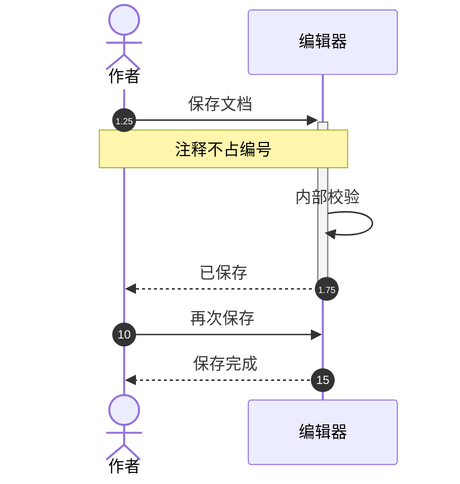

参与者可以用 `@{"type":"类型"}` 指定符号：`boundary`（边界）、`control`（控制）、`entity`（实体）、`database`（数据库）、`collections`（集合）、`queue`（队列）；`actor` 和 `participant` 分别选择人物和矩形。`participant`、`actor` 和 `create participant / actor` 均可使用配置，`type` 优先于声明关键字。六类新符号和人物的名称显示在图形下方，创建消息按符号宽度连接，生命线从名称下方开始。 [Mermaid 参与者类型](https://mermaid.js.org/syntax/sequenceDiagram.html#boundary)

配置中的 `"alias"` 设置显示名称，同时填写外部 `as 名称` 时以外部名称为准；省略 `type` 则沿用声明关键字的默认符号。别名支持中文、JSON 转义引号、花括号和 `<br>` 换行。原生配置使用单行标准 JSON 对象，只接受字符串类型的 `type` 和 `alias`；未知类型、其他配置字段、YAML 写法、多行或无效 JSON 保留为可编辑源码。

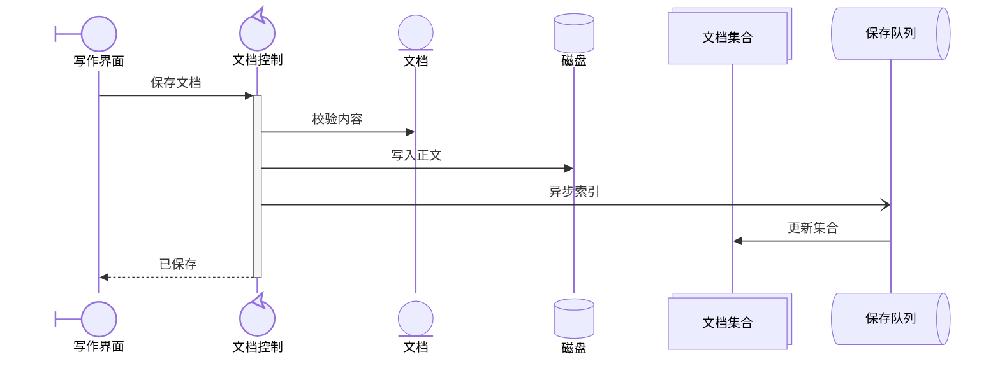

标签可用 `<br>` 换行，排版会为消息和注释留出空间。长标签最多显示四行，完整内容保留在源码。支持最多 8 个参与者、60 条消息或注释、24 个控制片段与 6 层嵌套。其他控制指令与配置保留为可编辑源码。 [Mermaid 时序图语法](https://mermaid.js.org/syntax/sequenceDiagram.html)

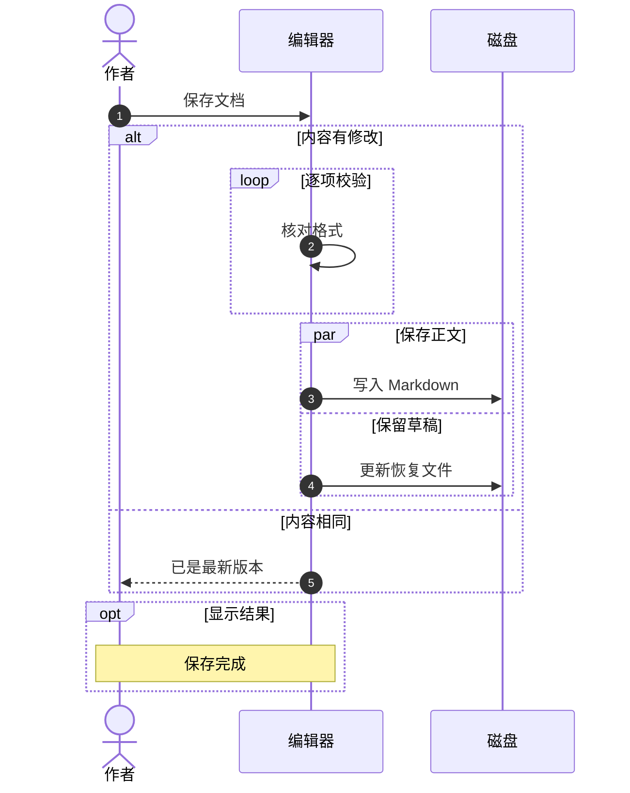

`box 名称 ... end` 把参与者组织为纵向分组。颜色可放在名称之前，支持 SVG 命名色（如 `Aqua`、`Purple`）、`rgb(...)` 和 `rgba(...)`；省略颜色时为透明背景。若名称本身是颜色词，可写 `box transparent Aqua`。分组标题自动换行并留出顶部空间，最多显示四行，余下内容以省略号提示，完整名称保留在源码。 [Mermaid 参与者分组](https://mermaid.js.org/syntax/sequenceDiagram.html#grouping--box)

分组块内填写 `participant` / `actor` 声明，消息写在组块结束之后。每位参与者只能属于一个组，成员列必须连续；最多支持 8 个非嵌套分组和总共 8 位参与者。空组、嵌套组、组内消息、无效 RGB/RGBA 颜色及 HSL / 十六进制颜色保留为可编辑源码。

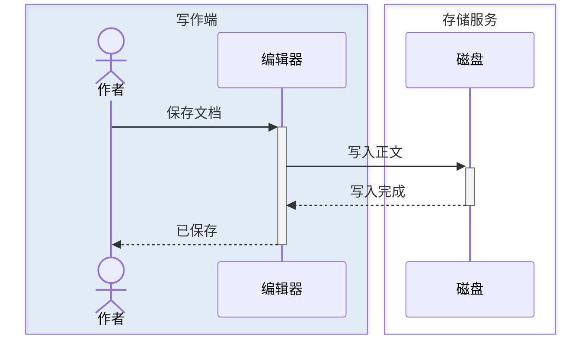

`critical` 图示关键操作，可以省略 `option`，也可以用多个 `option 条件` 描述异常处理。`break 条件` 图示指定条件下中断当前交互。它们可与条件、循环和并行片段嵌套；`option` 必须直接属于当前 `critical`，不能跨越尚未结束的内层片段。缺少 `end` 或分支归属错误时保留为可编辑源码。 [Mermaid 关键操作](https://mermaid.js.org/syntax/sequenceDiagram.html#critical-region)、[中断片段](https://mermaid.js.org/syntax/sequenceDiagram.html#break)

片段标题按可用宽度自动换行，也可用 `<br>` 手动换行，最多显示四行；超出的内容以省略号提示，完整条件保留在源码与保存文件中。

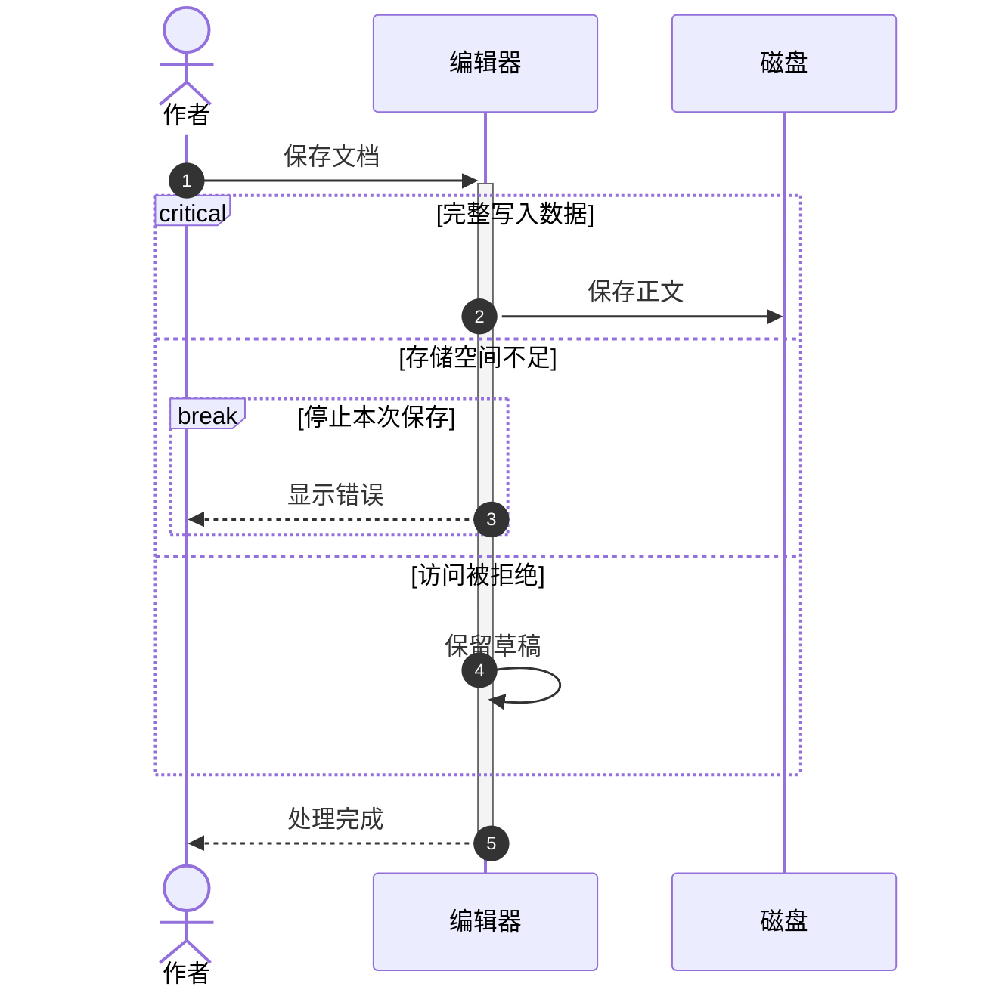

`rect rgb(R,G,B)` 或 `rect rgba(R,G,B,A)` 为一段交互添加背景高亮，以 `end` 结束，可嵌套并包含其他控制片段。RGB 通道取 0–255 的整数，RGBA 的透明度取 0–1；RGB 使用不透明色，RGBA 从外到内与底层颜色合成。高亮绘制在生命线、消息和注释下方，并与其他片段共用 24 个片段、6 层嵌套的上限。命名色、十六进制色、无效颜色和分支错配保留为可编辑源码。 [Mermaid 背景高亮](https://mermaid.js.org/syntax/sequenceDiagram.html#background-highlighting)

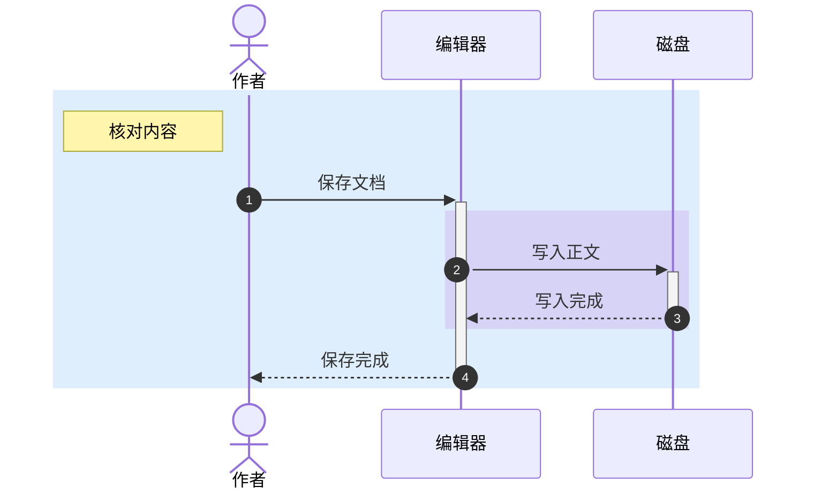

时序图支持以下标准消息线型；实线与虚线都支持自调用及 `+ / -` 激活简写。双向消息在两端绘制箭头，自调用时分别沿出发和返回方向绘制。 [Mermaid 消息语法](https://mermaid.js.org/syntax/sequenceDiagram.html#messages)

| 实线 | 虚线 | 显示 |
| --- | --- | --- |
| `->` | `-->` | 无箭头线段 |
| `->>` | `-->>` | 实心箭头 |
| `<<->>` | `<<-->>` | 两端实心箭头 |
| `-x` | `--x` | 末端叉号 |
| `-)` | `--)` | 异步开放箭头 |

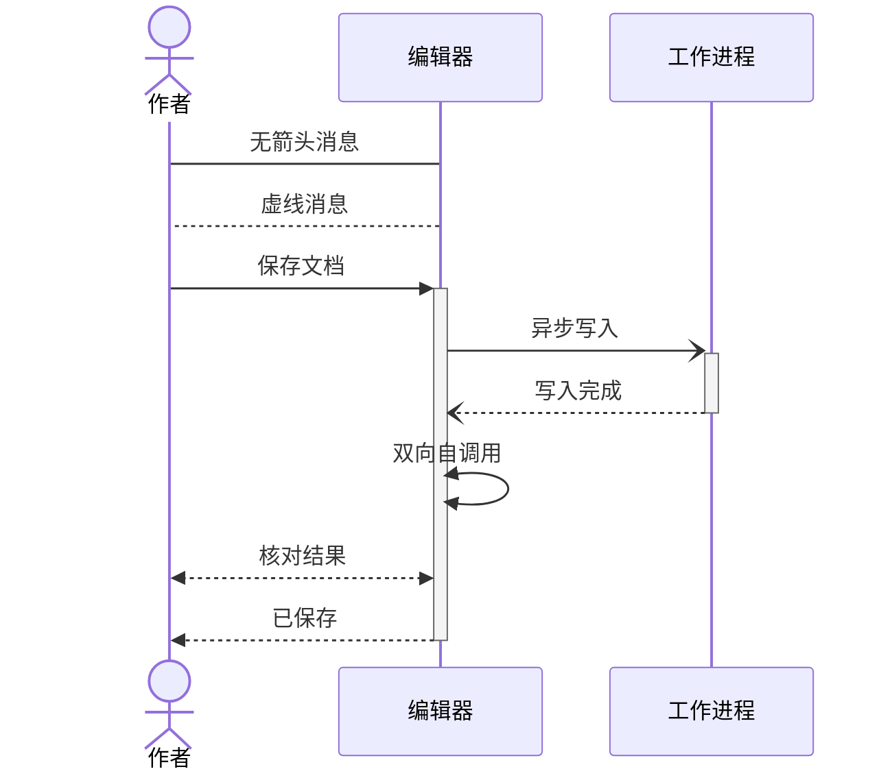

半箭头和 `()` 中心连接等其他箭头语法保留为可编辑源码。

`Note left of 名称` 和 `Note right of 名称` 把注释放在单个参与者左侧或右侧；`Note over 名称` 沿参与者生命线居中，`Note over A,B` 跨越两位参与者，交换顺序不影响位置。关键字不区分大小写，内容可用 `<br>` 换行。旁注会为激活条、相邻生命线和画布边缘留出空间。侧向注释仅支持一个参与者，多个参与者请用 `over`；无效位置或销毁后的引用保留为可编辑源码。 [Mermaid 注释语法](https://mermaid.js.org/syntax/sequenceDiagram.html#notes)

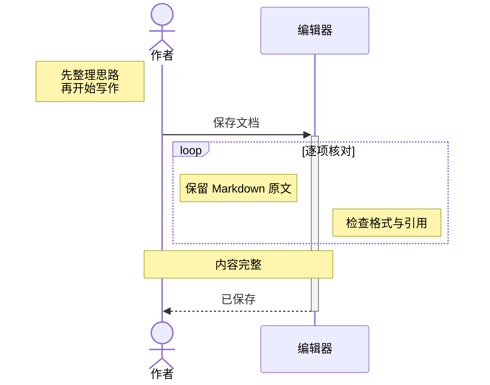

时序图可用 `activate 名称` 和 `deactivate 名称` 显示参与者的执行区间。消息箭头后的 `+` 激活接收方，`-` 停用发送方。激活同一参与者时会叠加激活条，停用时按后进先出的顺序收回；未结束的激活条会延伸到图底部。支持最多 64 段激活、每位参与者最多 8 层。停用未激活参与者的图表会保留为可编辑源码。 [Mermaid 激活条语法](https://mermaid.js.org/syntax/sequenceDiagram.html#activations)

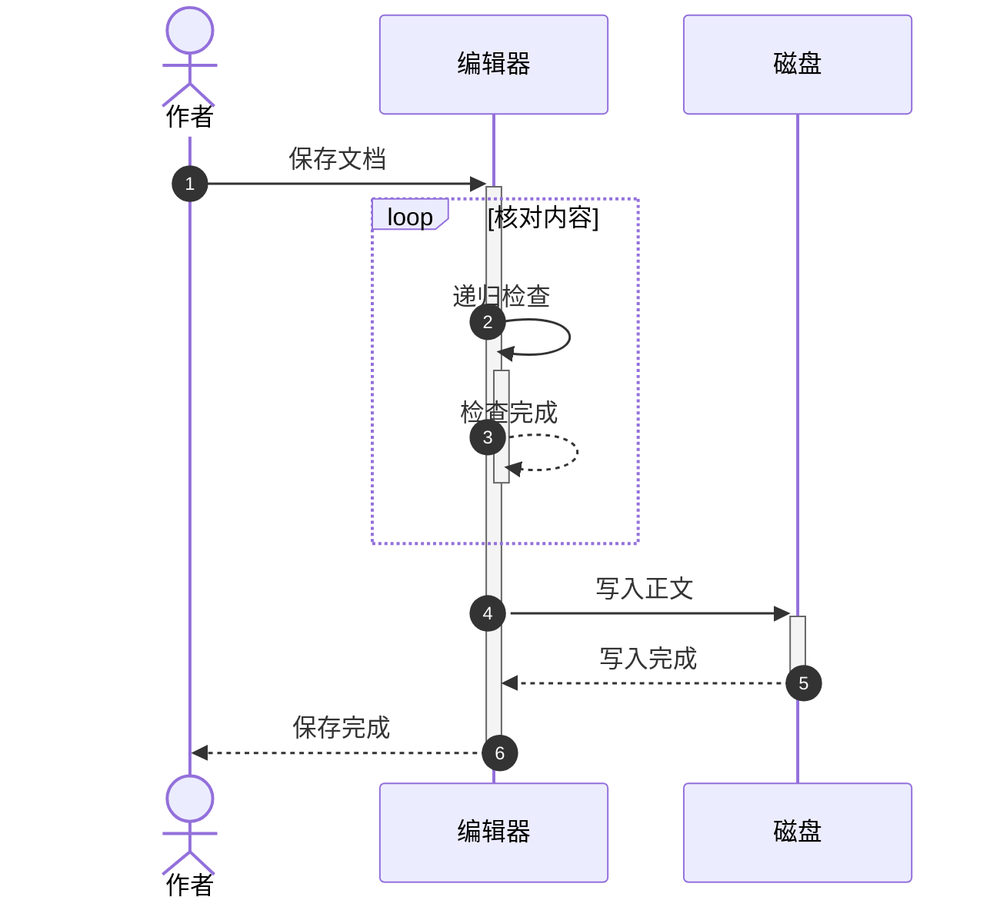

用 `create participant 名称` 或 `create actor 名称 as 别名` 创建参与者，其后的消息必须发给新参与者。创建消息连接新出现的标题，生命线从标题下方开始。用 `destroy 名称` 标记下一条发送或接收消息为销毁消息，在消息处绘制叉号并结束生命线，同时收回仍未关闭的激活条。`-x` 和 `--x` 分别表示实线和虚线叉号消息；单独使用叉号消息不会销毁参与者。 [Mermaid 创建与销毁语法](https://mermaid.js.org/syntax/sequenceDiagram.html#actor-creation-and-destruction-v1030)

每个标识符只支持一个生命周期。创建前可声明显示顺序，但不能已参与消息、注释或激活。创建或销毁指令与关联消息之间仅允许空行和注释；重复创建、未关联消息、销毁后继续引用等情况会保留为可编辑源码。

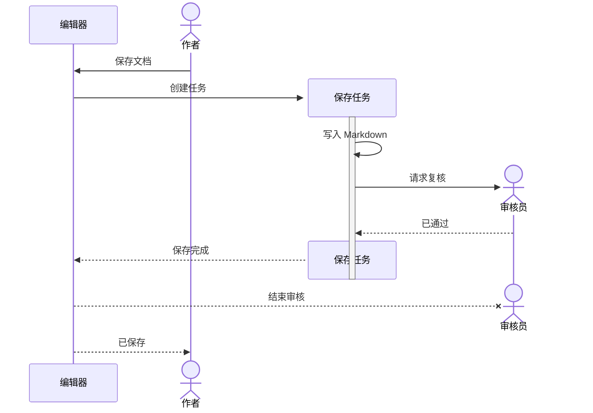

`pie` 绘制饼图。用双引号包围名称，每行写一个数值。扇区按源码顺序顺时针排列，图例可通过 `showData` 显示数值。标题可写在 `pie` 同一行或单独一行。支持整数和小数，最多 64 项，并要求总值大于零。零值留在图例中。 [Mermaid 饼图语法](https://mermaid.js.org/syntax/pie.html)

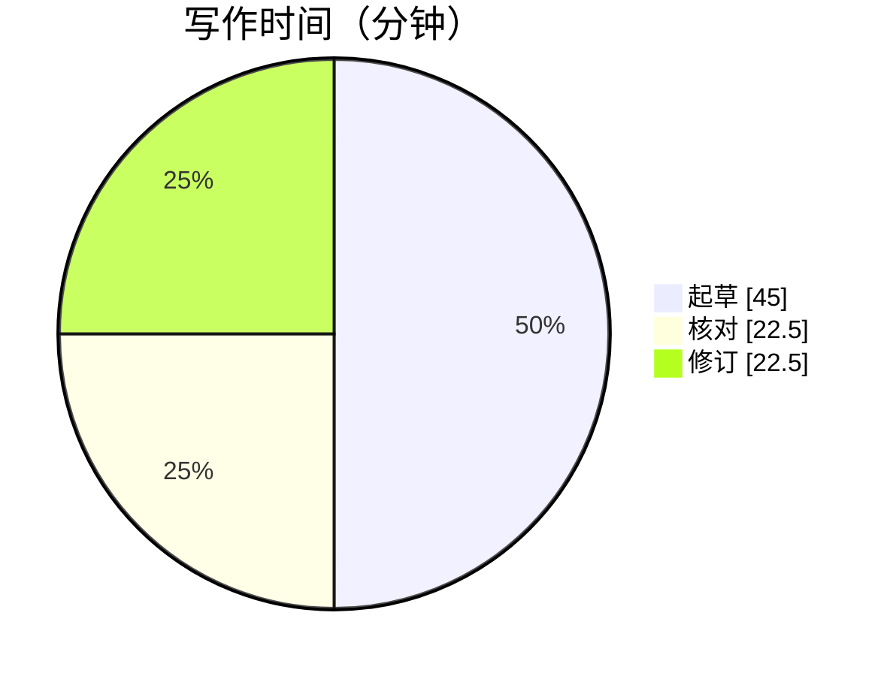

`timeline` 按源码顺序绘制时间线。用 `title` 添加标题，用 `section` 分组，事件可用冒号和空格接在时期后，或在续行以冒号和空格开头。时期和事件支持文字、日期以及 `<br>` 换行。每行最多放四个时期，时间线最多支持 24 个时期和 64 个事件。 [Mermaid 时间线语法](https://mermaid.js.org/syntax/timeline)

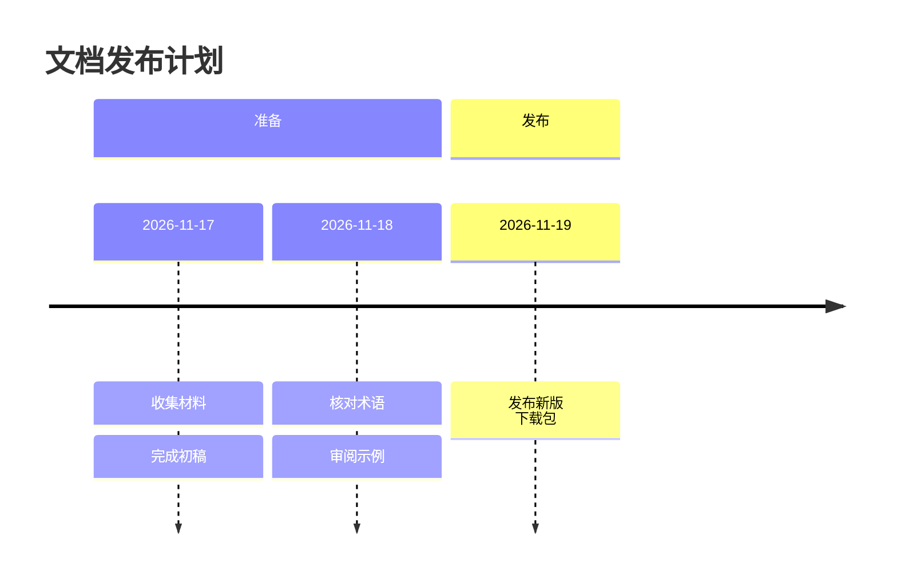

`mindmap` 按缩进组织节点。首个节点是根，每行接到最近一个缩进更少的节点。一级分支分布在根节点两侧，同一分支及其后代使用相同的配色。支持普通文字、方框 `id[名称]`、圆角框 `id(名称)`、圆形 `id((名称))`、六边形 `id{{名称}}`、云形 `id)名称(` 和星芒 `id))名称((`。

标签支持中文自动换行与 `<br>`，每个节点最多显示四行，完整文字保留在源码中。可在节点后另起一行用 `::icon(fa fa-book)`、`fa-lightbulb` 或 `fa-check` 加入内置的书本、灯泡和对勾图标。单图最多 48 个节点、8 层。其他图标、Markdown 富文本标签、自定义样式和配置保留为可编辑源码。 [Mermaid 思维导图语法](https://mermaid.js.org/syntax/mindmap.html)

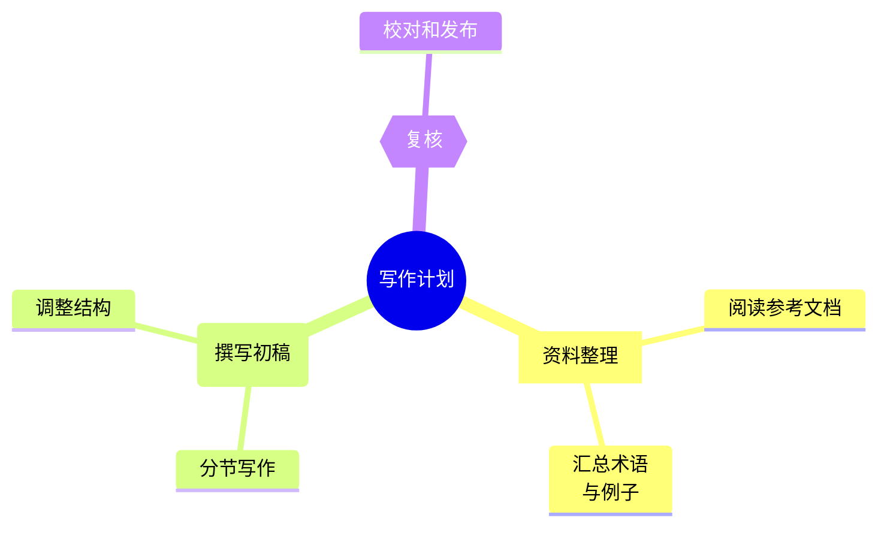

`quadrantChart` 绘制四象限图。可用 `title` 添加标题、用 `x-axis` 和 `y-axis` 写轴的两端文字，也可只写低值端。象限编号从右上方起逆时针排列。用 `名称: [x, y]` 添加散点，两坐标均在 0 到 1 之间，最多 32 个点。省略散点时可用作空白矩阵。标注密集时，图内放不下的点名和坐标会列在图下。过长的标签会截短显示，源码保留完整内容。点样式、样式类及图表配置会保留为可编辑源码。 [Mermaid 四象限图语法](https://mermaid.js.org/syntax/quadrantChart.html)

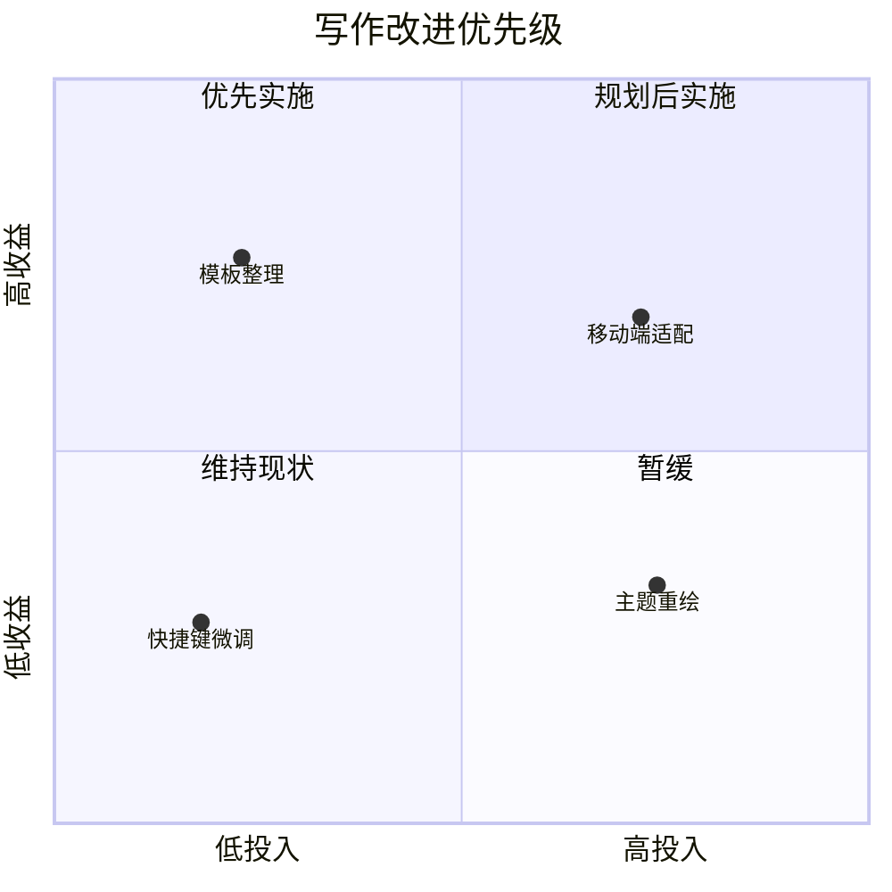

`sankey` 和 `sankey-beta` 绘制桑基图。每条记录按来源、去向、数值填写三列 CSV。名称中包含逗号或换行时用双引号包围，字段内的双引号写作两个连续引号。空行及 `%%` 注释行可以用于分组。

图从左向右展示分流和汇流。流带宽度与数值成比例，节点旁显示流入或流出两者中的较大总量。同一对节点的多条记录会合并为一条流带，零值记录不生成流带。支持最多 64 个节点和 128 条记录，至少一条记录需要正值。循环流向和自定义配置保留为可编辑源码。 [Mermaid 桑基图语法](https://mermaid.js.org/syntax/sankey.html)

```mermaid
sankey
    %% 来源,去向,工作量
    写作计划,整理素材,12
    写作计划,直接起草,8
    整理素材,撰写正文,9
    整理素材,参考归档,3
    直接起草,撰写正文,8
    撰写正文,"复核、校对",17
```

`gitGraph` 绘制 Git 分支和提交历史。初始分支为 `main`。用 `commit` 添加提交、`branch` 创建并切换分支、`checkout` 或 `switch` 切换已有分支，再用 `merge` 合并另一分支的最新提交。用 `id: "名称"` 添加提交名称、用 `tag: "版本"` 添加标签。未指定 ID 的提交按顺序显示为 `c1`、`c2`。

用 `type: HIGHLIGHT` 突出显示提交，`type: REVERSE` 表示撤销，合并提交带双圈。分支默认按创建顺序排布，可用 `branch 名称 order: 正整数` 排序；带顺序值的分支排在其余分支之后，`main` 始终在首位。可选择 `gitGraph LR:`、`gitGraph TB:` 或 `gitGraph BT:` 布局。支持最多 8 个分支与 32 个提交。过长的名称会截短显示，源码保留完整内容。`cherry-pick` 与自定义配置保留为可编辑源码。 [Mermaid GitGraph 语法](https://mermaid.js.org/syntax/gitgraph.html)

```mermaid
gitGraph
    commit id: "起点"
    branch writing
    commit id: "完成初稿"
    checkout main
    commit id: "修复问题" type: REVERSE
    checkout writing
    commit id: "复核" type: HIGHLIGHT
    checkout main
    merge writing id: "合并写作" tag: "v1.0"
    commit id: "发布"
```

`xychart` 和 `xychart-beta` 支持柱形图 `bar`、折线图 `line` 和组合图。在图表声明后加 `horizontal` 可以横向绘制。两条轴都可命名，X 轴可指定类别或数值范围，Y 轴可指定范围或由数据推算。柱形图自动推算时包含零点。带名称的系列显示在图例中。

类别与数据按位置对应。图表最多支持 8 个系列，每个系列最多 32 个值。标签较密时会减少刻度标签，导出仍保留全部已绘制数据。 [Mermaid XY 图语法](https://mermaid.js.org/syntax/xyChart)

```mermaid
xychart
    title "每月产量（件）"
    x-axis "月份" [一月, 二月, 三月, 四月]
    y-axis "数量" 0 --> 100
    bar "实际" [40, 65, 72, 83]
    line "目标" [50, 60, 75, 80]
```

`stateDiagram` 和 `stateDiagram-v2` 绘制基础状态图。用 `[*]` 表示开始或结束，用 `-->` 连接状态。冒号后的文字可说明状态或转换，`state "显示名称" as ID` 可为状态命名。支持方向设置、双向转换、自转换与 `<<choice>>` 分支。复合状态、并发、注释框和自定义样式保留为可编辑源码。 [Mermaid 状态图语法](https://mermaid.js.org/syntax/stateDiagram.html)

```mermaid
stateDiagram-v2
    state "等待编辑" as Idle
    state "编辑中" as Active
    [*] --> Idle
    Idle --> Active : 打开文档
    Active --> Active : 自动保存
    Active --> Idle : 关闭文档
    Active --> [*] : 退出应用
```

`classDiagram` 支持类名、自定义显示名称、类注解、属性和方法。成员可写在类的花括号内，也可写作 `Class : 成员`。保留可见性符号，静态成员加下划线，抽象方法用斜体。支持继承、实现、组合、聚合、关联与依赖，关系可附文字说明和双端多重性。用 `direction` 设置上下或左右布局。单图最多 24 个类或圆形接口节点、48 条关系，每类最多 18 个成员。交互指令保留为可编辑源码。 [Mermaid 类图语法](https://mermaid.js.org/syntax/classDiagram.html)

```mermaid
classDiagram
    class Document["文档"] {
        -String title
        +save() bool
    }
    class MarkdownDocument["Markdown 文档"] {
        +toMarkdown() String
    }
    class Section["章节"]
    Document <|-- MarkdownDocument
    Document "1" *-- "1..*" Section : 包含
```

用 `namespace 名称 {` 与单独一行的 `}` 为类分组，`namespace 名称["显示名称"] {` 可设置分组标题。支持最多 8 个平级分组、中文和反引号名称，以及多行空分组。组内仅放类声明及其成员块；关系、独立成员指令、注释、样式和方向写在组外。类 ID 全局有效，关系可先于分组声明。同一命名空间可再次打开，合并其中的类；已有显示名称保留，直到显式指定新的显示名称。先在组外出现的类可加入分组，此后组外声明保留其归属；将同一个类分配给两个不同分组会保留整图源码。

分组随 `TD / TB / BT / LR / RL` 排布。上下布局时组内类横排，左右布局时组内类纵排，顺序取类首次出现顺序；跨组关系从分组边缘连接，注释为关联类预留空间。类的泛型、成员、自定义名称和样式继续生效；默认样式用于类与圆形接口，分组容器使用主题配色。圆形接口在分组外独立布局。标题过长时省略显示，完整内容保留在 Markdown 中。HTML、PDF、DOCX 和 EPUB 导出包含分组图像。嵌套、未加反引号的点分命名空间、分组容器样式及组内关系等扩展语法保留为可编辑源码。 [Mermaid 命名空间](https://mermaid.js.org/syntax/classDiagram.html#define-namespace)

```mermaid
classDiagram
    direction TB
    namespace Editing["编辑模块"] {
        class Editor~Document~ {
            +List~Document~ documents
            +save() bool
        }
        class Document["文档"]
    }
    namespace Storage["存储模块"] {
        class Repository {
            +write(Document)
        }
    }
    class App["应用"]
    App --> Editor : 打开
    Editor "1" o-- "*" Document : 包含
    Document --> Repository : 保存
    App --> Repository : 直达
    Repository --> Repository : 重试
    Repository --() Disk
    note for Editor "Markdown 编辑与预览\n保留源码"
    note "模块关系"
    classDef storage stroke:#5488c9,stroke-width:2
    cssClass "Repository" storage
```

圆形接口（lollipop）使用 `Input ()-- Writer` 或 `Writer --() Storage`，以带名称的圆圈和实线表示接口与类的连接，可用 `: 说明` 添加关系文字。支持五种方向、深浅主题、中文及反引号包围的接口名称；过长名称显示省略号。每次出现都会创建独立接口，同名接口也不会共享。 [Mermaid 圆形接口](https://mermaid.js.org/syntax/classDiagram.html#lollipop-interfaces)

接口端的名称用于显示，不是普通类 ID。例如 `Writer --() Storage` 后再声明 `class Storage`，会得到一个独立的普通类和一个圆形接口。`note for`、`style` 和 `cssClass` 继续通过普通类 ID 定位，不会选中同名圆形接口；`classDef default` 可统一设置类和接口的填充、文字及边框样式。普通类端可与泛型、自定义名称、成员、注释及样式组合。接口每次出现均计入单图最多 24 个节点的限制，关系仍最多 48 条。虚线、箭头、双端圆形接口和接口关系上的多重性保留为可编辑源码。完整指令保留在 Markdown 中，HTML、PDF、DOCX 和 EPUB 导出包含接口图像。

```mermaid
classDiagram
    direction LR
    class Writer~Document~:::primary {
        +List~Document~ items
        +save() bool
    }
    class Document["文档"]
    Input ()-- Writer : 提交
    Writer --() Storage : 保存
    Document --() Storage : 归档
    Writer "1" o-- "*" Document : 管理
    note for Writer "Markdown 接口\n同名接口各自独立"
    classDef primary fill:#e3edff,stroke:#5488c9,color:#243249,stroke-width:2
```

类图泛型写作 `class Repository~Document~`，图中显示为 `Repository<Document>`。属性、方法参数和返回值也支持相同写法，例如 `List~Document~ items`、`find(List~String~ keys) List~Document~`；`List~List~int~~` 显示为 `List<List<int>>`。成员开头的 `~` 仍表示内部可见性，末尾的 `$` / `*` 仍用于静态 / 抽象格式。 [Mermaid 泛型类型](https://mermaid.js.org/syntax/classDiagram.html#generic-types)

支持最多 8 层嵌套的单类型参数。类型名可使用字母、数字、下划线、点或连字符连接的名称及 `[]` 数组后缀，支持中文类型名；类型参数内部使用紧凑写法，不含空格或逗号。方法的多个参数可在泛型外使用逗号分隔。空参数、未闭合泛型、超出深度、逗号类型参数及同一类 ID 的不同泛型声明均保留为可编辑源码。

泛型不属于类 ID。声明 `Repository~Document~` 后，关系、成员、注解、注释及样式仍引用 `Repository`；这些引用可以写在泛型声明之前。重复相同泛型或后续省略泛型会保留原有类型。显示名称只替换基础名称，泛型后缀仍会显示，例如 `class Repo~T~["仓库"]` 显示为 `仓库<T>`。过长的类型按类框宽度显示省略号，完整泛型指令保留在 Markdown 中，HTML、PDF、DOCX 和 EPUB 导出包含渲染结果。

```mermaid
classDiagram
    direction LR
    class Repository~Document~:::primary {
        <<interface>>
        -List~Document~ items
        +List~List~int~~ matrix
        +find(List~String~ keys,Set~int~ ids) List~Document~
        ~refresh(List~Document~ docs)$
        +create() Box~Document~*
    }
    class Document["文档"]
    Repository "1" o-- "*" Document : 管理
    note for Repository "Markdown 泛型仓库\n关联仍使用原类 ID"
    classDef primary fill:#e3edff,stroke:#5488c9,color:#243249,stroke-width:2
```

类图注释使用 `note "说明"`，关联到类时写作 `note for 类ID "说明"`。独立注释放在图下方；关联注释以虚线连接到类，在上下布局时放在类的右侧，左右布局时放在类的下方，并为关系线预留空间。也可只包含独立注释。注释须写在类的花括号外，允许先写关联注释、后声明目标类；目标使用类 ID（支持中文和反引号包围的 ID），不是自定义显示名称。不存在的目标或错误语法会使整图保留为可编辑源码。

注释正文用同一物理行上的双引号包围，`\n` 或 `<br>` / `<br/>` / `<br />` 表示换行，`\"` 和 `\\` 表示引号和反斜杠，其余反斜杠序列保留字面内容。支持中文自动换行与深浅主题。单图最多 16 条注释，每条最多展示 6 行，超出部分用省略号标示；完整文字保留在 Markdown 中。HTML、PDF、DOCX 和 EPUB 导出包含注释图像。

```mermaid
classDiagram
    direction LR
    note "文档关系\n说明保留在源码"
    note for Document "保存与导出\n在本地完成"
    class Document["文档"]
    class Resource["资源"]
    Document "1" o-- "*" Resource : 使用
    note for Resource "图片、公式与图表<br>随文档导出"
```

类图样式使用 `style 类ID 属性` 单独设置，或通过 `classDef 样式类名 属性` 定义，再用 `cssClass "类ID1,类ID2" 样式类名` 附加。`class 类ID:::样式类名` 是简写，可放在成员花括号之前；带显示名称时可写作 `class Doc["文档"]:::primary`。样式类名由英文字母、数字、下划线和连字符组成，`classDef first,second 属性` 可同时定义多个样式类。类 ID 支持中文和反引号包围的名称；`cssClass` 列表中的反引号内可含空格或逗号。每行一条指令，可在行末加分号。 [Mermaid 类图样式](https://mermaid.js.org/syntax/classDiagram.html#styling)

支持 `fill`、`stroke`、`color`、`stroke-width` 和 `stroke-dasharray`，取值及转义逗号规则与前述流程图样式相同：线宽为 0 或 0.1–12px，虚线最多 8 个 0.1–64px 的值。填充应用于整个类框；文字色应用于名称、类注解、属性与方法；边框样式同时应用于成员分隔线。显式颜色在深浅主题中保留，关系线与注释继续采用主题颜色，类框尺寸及布局保持不变。

样式按「主题默认值 → `default` 样式类 → 按附加顺序的命名样式类 → 类的 `style`」逐属性叠加。重复定义仅覆盖本次指定的属性。`node` 在类图中是普通样式类，需要显式附加。样式与附加指令可以先于类声明，目标须在整图解析结束前存在；目标使用类 ID，不使用显示名称。单图最多 32 个样式类，每个类最多附加 16 次，每条样式声明最多 32 个属性。缺失目标、缺失样式类、无效属性或超限值保留为可编辑源码；字体、外部 CSS 和注释单独配色尚未支持。样式随图像嵌入 HTML、PDF、DOCX 和 EPUB，Markdown 保留原始指令。

```mermaid
classDiagram
    direction LR
    class Document["文档"]:::primary {
        <<interface>>
        +String title
        +save() bool
    }
    class Resource["资源"]
    Document "1" o-- "*" Resource : 使用
    cssClass "Resource" asset
    note for Document "Markdown 保存与导出\n保留完整源码"
    classDef default fill:#edf3fb,stroke:#8ca4ca,color:#243249
    classDef primary fill:#e3edff,stroke:#5488c9,stroke-width:3
    classDef asset fill:#e0f1e8,stroke:#469875
    style Resource stroke-width:2px,stroke-dasharray:5 3
```

`gantt` 绘制按日期排列的项目计划。用 `title` 添加标题、`section` 分组。日期采用 `YYYY-MM-DD`，工期支持分钟 `m`、小时 `h`、天 `d` 和周 `w`，精确到分钟。可直接写开始和结束日期，也可指定任务 ID，通过 `after` 接续一个或多个任务；省略开始时间时接续上一项，首项须提供日期或依赖。使用 `done`、`active`、`crit` 和 `milestone` 标记状态。

`excludes` 可指定 `weekends` 或单个日期。排除日在图中有底色。以工期指定的任务遇到排除日时会顺延。任务尾部遇到排除日时，图条在休假前结束，后续任务从休假后接续。明确指定结束日期的任务保留原日期。单图最多 24 项任务和约十年跨度。自定义日期格式、`until`、自定义坐标轴或样式会保留为可编辑源码。 [Mermaid 甘特图语法](https://mermaid.js.org/syntax/gantt.html)

```mermaid
gantt
    title 文档发布计划
    dateFormat YYYY-MM-DD
    excludes weekends, 2026-11-25
    section 准备
        整理资料 :done, draft, 2026-11-19, 2d
        技术复核 :active, review, after draft, 2d
    section 发布
        校对样例 :crit, check, after review, 1d
        发布新版 :milestone, after check, 0d
```

脚注使用 `[^note]` 引用和 `[^note]: 注释内容` 定义；后续行缩进四个空格。点击引用跳转到定义，正文与定义均保留在 Markdown 中，未引用的定义也会保留。定义区当前直接展示可编辑的原始内容。Word 导出使用原生脚注；HTML 输出带跳转的脚注区；PDF 将定义放在文末。

单独一段的 `[TOC]` 或 `[toc]` 会生成正文目录，也可输入后按 Enter 渲染。目录根据当前标题自动更新，点击条目跳到对应标题。保存时仍是 `[TOC]`，生成文字不会写回 Markdown。PDF 将目录展开为可跨页的段落；Word 输出包含缓存条目与内部链接的 TOC 域，可在 Word 中更新目录。

HTML / PDF / DOCX 中的公式和受支持图表内嵌为双倍分辨率图片。Word 中的公式图片不能作为原生公式对象编辑；继续修改原始 Markdown 可重新导出。HTML 无需外部脚本或网络。引用、嵌套结构中无法原生排版的块保留 Markdown 源码；代码围栏内、行内代码、转义美元符号与常见货币文本不会被改成公式。
