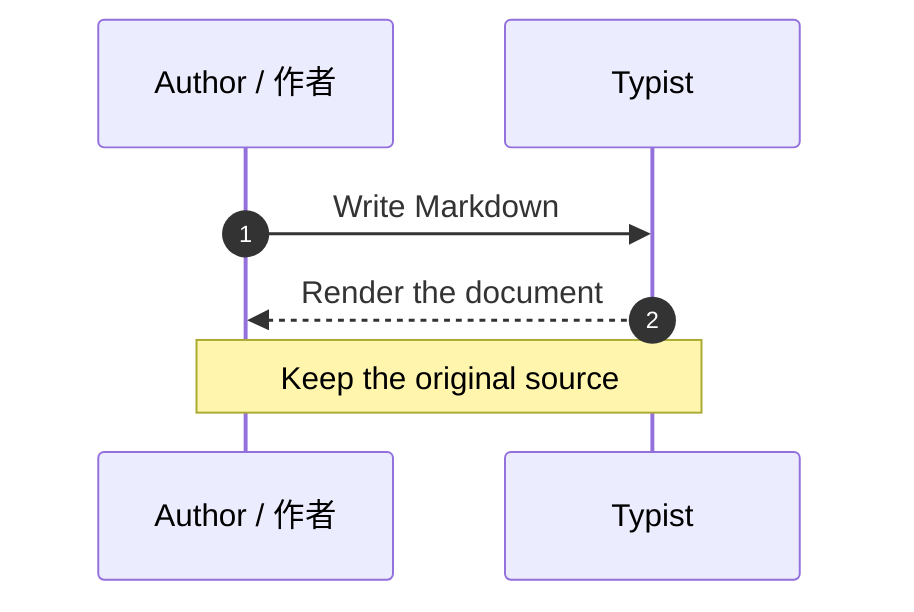

# Ideas, beautifully expressed

[TOC]

## Mathematics / 数学公式

A small idea $E=mc^2$ can carry a large meaning. 数学与文字自然相伴。[^note]

$$
\frac{-b \pm \sqrt{b^2-4ac}}{2a}
$$

## A clear process / 清晰的流程

## A conversation / 交互时序

[^note]: Markdown 源码始终保留。公式和图表可双击继续编辑。
    Word 使用原生脚注，HTML 可点击引用跳转。
